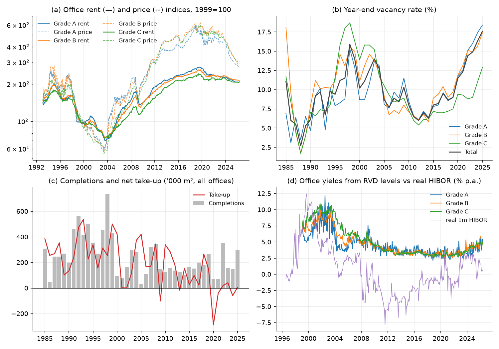

# Hong Kong Property Market Research

Two empirical studies of Hong Kong housing and office markets, combining
interest-rate models, time-series diagnostics, rolling forecast comparisons,
and office vacancy scenarios. The Python code covers data validation,
econometric estimation, simulation, and figures.



## Studies and results

| Study | Questions | Methods |
| --- | --- | --- |
| [Housing](hk-housing/src) | Price dynamics, rates and fundamentals, policy events, forecast accuracy | Recursive right-tailed ADF tests, cointegration and error correction, interrupted time series, local projections, rolling forecasts |
| [Offices](hk-office/src) | Rent adjustment, vacancy, supply absorption, district differences | Present-value decomposition, vacancy adjustment and state-space models, stock-flow scenarios, structural breaks, rolling forecasts |

Both monthly panels contain 400 observations from January 1993 through
April 2026. Some office analyses use longer quarterly and annual histories.
Results reflect the original 2026 source snapshot, rather than a live update.
Estimates below come from the saved results in each study's `output/`
folder. Critical values quoted from published tables, the notes on
simulation-seed sensitivity, the pre-correction comparison and the
scikit-learn 1.9.1 rerun of the housing forecasts come from separate runs.
P-values are not adjusted for the many specifications tested.

## Main findings

### Housing

**Explosive episodes** ([bubble tests](hk-housing/output/bubbles.json),
[figure](hk-housing/figures/fig3_bsadf.png))

- One-lag GSADF tests over 400 months find no robust bubble. Against Monte
  Carlo critical values simulated with the same one-lag regression (49,999
  draws), only real prices reject at 5% (2.48 vs 2.39, p = 0.038). That
  maximum comes from a four-month burst (October 2022–January 2023, peaking
  in December) during a sharp fall in real prices, too short to be dated. A
  wild bootstrap whose null keeps both the serial correlation (a
  Phillips–Shi autoregression) and the changing volatility (each residual
  stays at its own date) of monthly price changes gives p = 0.34 (nominal),
  0.21 (real) and 0.52 (price–rent). Zero-lag statistics look larger (2.93
  nominal, 3.03 price–rent) only because they ignore that serial correlation;
  against the same bootstrap null their p-values are 0.77 and 0.28. Failing
  to reject does not prove absence.
- BSADF date-stamping against the Monte Carlo sequence flags six
  nominal-price runs (1997–2018) with the saved simulation draw; a seventh,
  March–August 2017, exactly at the six-month minimum, is dated under most
  other draws. It also flags one six-month price–rent run (May–October 2024)
  and a 20-month real-price run
  (September 2023–April 2025) in which real prices fell about 15%, most
  steeply at the start (about 2% a month to February 2024, slowing after):
  a sharp decline, not a boom. Runs are dated even where the global test
  does not reject, so treat them as descriptive.

**Long-run equilibrium** ([estimates](hk-housing/output/longrun.json),
[figure](hk-housing/figures/fig4_equilibrium.png))

- Real prices show no detectable long-run link to real income and the real
  prime rate: ARDL bounds F = 1.19, below the two-regressor 5% lower bound
  (3.80), or 1.93 against 3.23 with housing stock per capita added (the
  stock series is spliced across the 2003 change in its official definition,
  which dropped village houses); error-correction t = −1.46; Gregory–Hansen
  never rejects. Johansen on price, income and housing stock per capita
  rejects no cointegration with two lagged differences (trace 39.0 vs 29.8),
  as it does at BIC's one and AIC's twelve, but not at three to eleven,
  including HQIC's three (trace 22.7). Every lag order implies an
  implausible income elasticity (5.8 to 12.4; 11.8 at two lags).
- The price–rent ratio and the real 1-month HIBOR give ARDL bounds F = 5.96,
  just above the one-regressor 5% upper bound of 5.72 (upper-bound
  p = 0.041). Ending the sample in December 2019 gives 5.71, a hair below
  that bound (p = 0.050), so the shorter-sample result is borderline. The
  DOLS semi-elasticity is −0.049 per percentage point. The error-correction
  coefficient implies a half-life near 59 months, but the t-statistic on the
  lagged level (−2.65) falls short of the 5% bounds (−2.86 and −3.22).
  Gregory–Hansen does not reject, and the relation
  disappears with the real prime rate (F = 3.52 on the same sample) or a
  composite funding rate (F = 3.98).

**Stamp-duty measures** ([estimates](hk-housing/output/policy.json),
[figure](hk-housing/figures/fig5_lp_irfs.png))

- With one or four events, Newey–West standard errors are not valid, so
  significance comes from placebo event dates: the same regression is rerun
  with the event moved to every eligible date more than two years from any
  measure, including the October 2023 partial relaxation. Shifting the whole
  four-event tightening calendar fits only in 1996–2008, so as a check the
  four months are also drawn independently, which uses 2018–2022 as well.
  Volume regressions include month-of-year effects.
- Pooled local projections over four 2010–2016 stamp-duty tightenings show
  transaction volume about 42% lower after 12 months (placebo p = 0.03, or
  0.02 with independently drawn months; 95% interval −66% to −0.2%). The fall
  is significant at 5% at 2, 8, 12 and 13 months and at 10% from 5 to 14
  months. Nominal prices did not fall: +3.9% at 12 months and +14.9% at 24
  months, neither significant under either placebo scheme (p ≥ 0.35).
  Interrupted-time-series dummies are all insignificant at 5%, with
  Newey–West errors that carry the same few-events caveat. These are
  associations, not causal effects.
- After the February 2024 abolition, volume was 134% higher two months later
  (p = 0.02) and 182% higher after 24 months (p = 0.03), with no significant
  difference in between. Price responses are small and insignificant at
  every horizon (+2.6% after two months, −6.5% after 12). This is a single
  event that followed a partial relaxation in October 2023, and it cannot be
  separated from concurrent rate and market shocks.

**Forecasting** ([summary](hk-housing/output/oos_summary.csv),
[figure](hk-housing/figures/fig6_forecast.png))

- Across 72 origins spaced two months apart (May 2013–March 2025),
  forecasting the log real price index with income as it was known at each
  origin, **no model significantly beats the random walk** at 1, 3 or 12
  months (Diebold–Mariano–HLN, unadjusted for 12 model–horizon comparisons).
- Autoregressive and error-correction forecasts cut 1- and 3-month RMSE by
  5–9%, but none is significant (p ≥ 0.117). Gradient boosting is 2.4% better
  at one month (p = 0.74). At 12 months the random walk has the lowest RMSE;
  the error-correction forecast (RMSE 10% higher, p = 0.027) and gradient
  boosting (59% higher, p = 0.017) are significantly worse. The
  error-correction forecasts use the income and prime-rate relation, not the
  price–rent and HIBOR one. Gradient-boosting numbers depend on the
  scikit-learn version (with 1.9.1 the one-month ratio is 0.94, p = 0.38),
  but no conclusion changes. None of this measures a trading return.

### Offices

**Valuations and interest rates** ([estimates](hk-office/output/longrun.json),
[figure](hk-office/figures/fig2_caprate_channel.png))

- Neither ARDL bounds (F = 3.31, upper-bound p = 0.27) nor Johansen (trace
  13.8 vs 15.5 at 5%) finds cointegration between the Grade A log price–rent
  ratio and the real 1-month HIBOR. The all-grade ratio's F = 4.26 (p = 0.14)
  is also below the one-regressor 5% lower bound (4.92). Evidence that office valuations price
  off real rates is weak, although non-rejection does not prove there is no
  link. An unrestricted system of real price, real rent and real HIBOR does
  have one cointegrating vector (trace 37.1 vs 29.8); the ratio tests above
  impose price–rent proportionality, which that system does not.
- Against the US 10-year Treasury yield less Hong Kong inflation, the tests
  disagree: Johansen rejects no cointegration (trace 18.2 vs 15.5), ARDL
  bounds does not (F = 1.05). A quarterly Campbell–Shiller decomposition
  assigns the price–rent ratio's variance mainly to expected future returns
  (share 1.09, of which the real prime rate −0.15) rather than expected rent
  growth (−0.09). The bootstrap 95% interval for the rent-growth share is
  wide (−0.68 to 0.57).

**Natural vacancy rate** ([estimates](hk-office/output/vacancy.json),
[figure](hk-office/figures/fig3_vacancy_rent.png))

- Hendershott rent-adjustment regressions on annual data (Grades A–C
  1987–2025, n = 39; total 1986–2025, n = 40) put the natural vacancy rate at
  9.2% (Grade A), 10.4% (B), 9.7% (C) and 10.1% (total). The estimates are
  imprecise: Grade A's adjustment speed is insignificant (t = 1.17). Its
  bootstrap 95% interval, from the 86% of draws with a positive adjustment
  speed, spans −8.8% to 19.0% (total market: 2.1% to 16.5%, from 94% of
  draws).
- A Kalman local-level model (adjustment speed fixed at the OLS value,
  fitted from several starting values) finds no drift in the natural rate
  for Grades A and B or for the total market: the estimated state variance
  is zero. Grade C's smoothed rate falls from 12.8% to 6.5% (first versus
  last five-year means), but a likelihood-ratio test cannot reject a constant
  rate (p = 0.09 against a simulated null). End-2025 vacancy (Grade A 18.4%, total 17.6%) exceeds the
  OLS estimates by 9.2 and 7.5 points.

**Absorbing the vacancy overhang** ([scenarios](hk-office/output/stockflow.json),
[figure](hk-office/figures/fig4_simulation.png))

- Completions fall, not rise, with lagged real prices (elasticity −0.37,
  t = −2.46), so supply enters as exogenous scenarios. Occupied-stock demand
  (DOLS) has income elasticity 0.79 and rent elasticity −0.21. Its
  error-correction speed is small and insignificant (−0.081, t = −0.9). The
  simulation floors it at 0.10 a year, slightly above the estimate, and
  absorption is still slow.
- Treating the end-2025 demand shortfall (occupancy 7.5% below the historical
  schedule) as permanent, simulated base-case total vacancy is **15.3%** in
  2035, above the fitted **10.1%** natural rate. Cutting completions to 30% of
  the 2021–25 pace reaches it by 2035 (base GDP) or 2033 (strong GDP). With
  faster adjustment (upper-bound speed 0.25) the base case normalizes in 2034.
  These are conditional simulations, not forecasts.

**District structure** ([estimates](hk-office/output/breaks.json),
[figure](hk-office/figures/fig5_regimes_districts.png))

- Bai–Perron (BIC) dates breaks in the log Central/Kwun Tong Grade A rent
  premium to September 2016 and July 2021. The premium rose from 1.07 to 1.18
  log points, then fell to 1.05, near its 2013–16 level; BIC barely prefers
  two breaks over three. Markov switching finds calm and volatile rent-growth
  regimes, each lasting about 13–14 months.
- Across all observed districts, the dispersion of the other districts' log
  Grade A rents relative to Central averages 0.250 before 2019 and 0.319
  since, but only because Kwun Tong, about 1.1 log points below Central,
  enters the panel in February 2013. On balanced panels, which hold the
  district set fixed, dispersion is essentially unchanged: 0.334 (February
  2013–2018) vs 0.318 (2019 on) across all six districts (HAC p = 0.17 for
  the change in mean), and 0.232 (1999–2018) vs 0.221 excluding Kwun Tong
  (p = 0.48). Three of six districts (Sheung Wan, Causeway Bay, Kwun Tong)
  are Engle–Granger cointegrated with Central at 5%; Mong Kok's result
  depends on how its reporting gaps are handled (p = 0.23 on its longest
  run after filling gaps of up to three months).

**Forecasting** ([summary](hk-office/output/oos_summary.csv))

- Over 132 expanding-window origins (May 2014 to April 2025), no model
  significantly beats a random walk for log real Grade A rents. The random walk
  with drift has the lowest RMSE ratios (0.99, 0.95, 0.89 at 1, 3 and 12 months)
  but unadjusted DM–HLN p ≥ 0.30. Error-correction and gradient-boosting
  forecasts do worse at every horizon.

## How the code fits together

Each study runs as a sequence of scripts, and every estimation script writes
its results to `output/`, so any step can be rerun and inspected on its own.
Office scripts read the processed panels from `data/processed/` (the
present-value decomposition also reads the raw HKMA lending-rate file).
Housing scripts rebuild the panel in memory from the raw files with
`pipeline.build_panel()`.

```text
input_manifest.json             required agency inputs, schemas and snapshot hashes
scripts/check_inputs.py         checks the inputs are present (optionally byte-identical)
        │
<study>/src/pipeline.py         parses agency workbooks and API extracts, splices and
        │                       deflates series, and stops on missing or duplicated months
        │                       (offices also on implausible vacancy and yield values
        │                       and on vacancy rates that disagree with vacancy/stock)
        │                       → data/processed/*.csv
        ▼
housing  psy.py (numba PSY engine)  → run_bubbles.py      explosive-episode tests
         longrun.py                 → run_longrun.py      unit roots, cointegration, ECM
         policy.py                  → run_policy.py       interrupted time series, local projections,
                                                          placebo-date inference
         forecast.py                → run_forecast.py     rolling five-model comparison
                                      run_robustness.py   aggregation, lag and segment checks
offices  longrun.py    cap-rate channel: cointegration and Campbell–Shiller decomposition
         vacancy.py    natural vacancy rate: Hendershott regressions and Kalman path
         stockflow.py  supply and demand estimation, stock-flow scenario simulation
         breaks.py     Bai–Perron breaks, Markov switching, district convergence
         forecast.py   → run_forecast.py   rolling five-model comparison
        │
        ▼
<study>/output/*.json|csv       every numerical result → make_figures.py → figures/*.png
                                                       → make_tables.py  → tables/*.md
```

The PSY recursive tests, their Monte Carlo nulls and the Phillips–Shi wild
bootstrap are implemented from scratch with numba and validated by
`hk-housing/src/test_psy.py`. The other estimators build on statsmodels,
arch, ruptures and scikit-learn.

## Run an offline example

Use Python 3.11. From this directory:

```sh
python3.11 -m venv .venv
. .venv/bin/activate
python -m pip install -r requirements.txt
python scripts/demo.py
python -m unittest discover -s tests -v
python hk-housing/src/test_psy.py
```

On Windows, activate with `.venv\Scripts\activate`. Dependencies are pinned
in `requirements.txt`. The demo uses explicitly synthetic monthly data and
prints a small forecast comparison; it needs no downloaded data or API key.
The tests check ADF and one-lag BSADF statistics against statsmodels, the
Monte Carlo and bootstrap nulls, bounds-test critical values, placebo-date
inference, point-in-time income, the housing-stock splice, office rate
parsing, the vacancy and district-dispersion estimators, forecast recursion
and calendars, and the arithmetic of the saved forecast results.
The separate PSY script checks exactness, simulated power, size, date-stamping,
and wild-bootstrap behavior. Initial numerical-library compilation can take
longer than subsequent runs.

## Reproduce the empirical studies

The full raw and processed datasets are not included. The
[input manifest](input_manifest.json) lists the **14 housing** and **13 office**
inputs, their required paths, schemas, source agencies, and snapshot hashes.
Sources are the Rating and Valuation Department, HKMA, Census and Statistics
Department, Land Registry, FRED, and World Bank; see
[Data sources and acknowledgements](#data-sources-and-acknowledgements).

Place your inputs at the listed paths under each study's `data/raw/` folder.
Some inputs are normalized CSVs: downloading a similarly named source file
alone is insufficient. The manifest describes the expected columns. This
release does not provide a complete download-and-normalize pipeline; original
snapshot inputs or equivalently prepared files are needed for full estimation.
New source vintages can revise past observations and change the results.

```sh
python scripts/check_inputs.py --study all
# Require byte-identical original inputs when checking exact replication:
python scripts/check_inputs.py --study all --strict-snapshot
```

With the housing inputs available, run in this order:

```sh
python hk-housing/src/pipeline.py
python hk-housing/src/run_bubbles.py
python hk-housing/src/run_longrun.py
python hk-housing/src/run_policy.py
python hk-housing/src/run_forecast.py
python hk-housing/src/run_robustness.py
python hk-housing/src/make_figures.py
python hk-housing/src/make_tables.py
```

For offices:

```sh
python hk-office/src/pipeline.py
python hk-office/src/longrun.py
python hk-office/src/vacancy.py
python hk-office/src/stockflow.py
python hk-office/src/breaks.py
python hk-office/src/run_forecast.py
python hk-office/src/make_figures.py
python hk-office/src/make_tables.py
```

Each script resolves paths from its own location. Estimation includes nested
rolling fits and simulation loops and can take substantially longer than the
demo. Running these commands overwrites that study's numerical results and
figures. Input data, generated tables, logs, caches, and PDF figure exports
are ignored by Git.

## Interpretation and verification

Forecasts use expanding training samples and evaluate 1-, 3-, and 12-month
horizons against random-walk, drift, autoregressive, error-correction, and
gradient-boosting models. The forecast ECM uses a static OLS long-run relation;
separate long-run research modules also estimate DOLS models.

These are retrospective, pseudo-out-of-sample evaluations using a single
source vintage. Housing forecasts use income only as it would have been
known at each origin: a quarter's median counts from two months after the
quarter ends and is carried forward. The in-sample models use income
interpolated between quarters. Later data revisions are not reconstructed.
Overlapping forecast errors are handled by the implemented DM–HLN comparison,
but p-values are not adjusted across all research specifications. Policy
event estimates describe associations, and failure to reject a bubble test
does not prove the absence of a bubble.

ARDL bounds critical values and p-values come from statsmodels' simulated
Pesaran–Shin–Smith distributions for the actual number of regressors (5%
bounds 4.92 and 5.72 with one regressor, close to the published 4.94 and
5.73).
statsmodels' `bounds_test` also counts the dependent variable as a
regressor, so the code keeps only its F statistic. In the housing study,
AIC chooses the lag orders among models that keep every regressor of a
specification; the office bounds tests use a fixed two-lag specification.

Corrections were made in two rounds in September 2026, and the affected
results were rerun with the pinned `requirements.txt`. In the first round,
three were made. First, the saved bounds
critical values and p-values had been one regressor too lenient. Second,
when AIC dropped a regressor, the remaining lag orders were matched to the
wrong columns. The housing income, rate and housing-stock test had therefore
run on income and the rate alone, and the pre-2019 income and rate test on
income alone. Third, SADF had used no lag while GSADF and BSADF used one; all
three now use one. The office dispersion comparison is now also saved for
balanced district panels.

A second review corrected the following. The office pipeline had read the
2017 total vacancy rate, stored in the source workbook as the text "9.5%", as
missing. It now parses percentages and checks every rate against
vacancy/stock. The Kalman natural-rate model now starts from several values
and keeps the highest likelihood; the previously reported drift in the
total-market rate was a local optimum. The office asymmetry test now leaves
the natural rate free under the null. The dispersion change is tested with
HAC errors, because Levene's test compares only variability. Engle–Granger
tests no longer bridge long reporting gaps. The Campbell–Shiller bootstrap
now keeps the VAR intercept. The PSY Monte Carlo nulls now use the tested
statistic's lag order and 49,999 draws; with 999 draws the dated runs were
strongly seed-dependent, and now only runs at the six-month minimum are. The
wild bootstrap now keeps the serial correlation of monthly changes. Policy
responses use placebo-date inference and seasonal controls for volume. The housing stock is spliced
across its 2003 definition change. Housing forecasts no longer see income
from quarters that had not yet been published; that leak had made gradient
boosting look significant at one month (p = 0.037).

The ECM forecast originally iterated its two lagged changes in the wrong
order. It was corrected, and the ECM forecasts and summary statistics were
recomputed. After the second round of corrections, every housing result,
including the forecast comparison, and every office result except the
forecast comparison were regenerated from the original local inputs with the
pinned `requirements.txt`. Two independent full reruns produce identical
published outputs. The office forecasts are not affected by the corrections.
They reproduce to within 1e-14 under the library versions that produced them
(numpy 1.26.4, pandas 2.3.0, scikit-learn 1.8.0). With the pinned
`requirements.txt` they reproduce to within 3e-9 for every model except the
autoregressive benchmark, whose maximum-likelihood ARIMA fits differ by up to
5e-4 under numpy 2. The office Markov-switching fit seeds its random
start-parameter search, so reruns reproduce it exactly; 31 different seeds
reach the same maximum likelihood to within 1.3e-6.

## Data sources and acknowledgements

No source dataset is redistributed here. The saved results and figures
contain series that the author derived from the official statistics below,
such as log, deflated or rebased price and rent indices, vacancy rates and
interest rates. Those derived series are the author's own calculations, not
official statistics, and no endorsement by any source is implied.
Intellectual property rights in the underlying data belong to the sources
named. Everything is provided as is; refer to the sources for authoritative
and revised figures. Inputs are a June 2026 snapshot.

- **Rating and Valuation Department, Government of the Hong Kong Special
  Administrative Region**: Property Market Statistics (price and rental
  indices, average rents and prices, completions, stock, vacancy and
  take-up), from the
  [department's statistics pages](https://www.rvd.gov.hk/en/publications/property_market_statistics.html),
  also listed on
  [DATA.GOV.HK](https://data.gov.hk/en-data/dataset/hk-rvd-tsinfo_rvd-property-market-statistics).
- **Census and Statistics Department, Government of the Hong Kong Special
  Administrative Region** (www.censtatd.gov.hk): Composite Consumer Price
  Index, median monthly domestic household income and mid-year population.
- **Hong Kong Monetary Authority**: Monthly Statistical Bulletin interest
  rates (interbank rates, Best Lending Rate, composite interest rate) and
  the Residential Mortgage Survey, through the
  [HKMA open API](https://apidocs.hkma.gov.hk/). The Hong Kong dollar
  interest settlement rates (HIBOR) are sourced from and owned by The Hong
  Kong Association of Banks.
- **The Land Registry, Government of the Hong Kong Special Administrative
  Region**: monthly statistics on agreements for sale and purchase of
  residential units, also listed on
  [DATA.GOV.HK](https://data.gov.hk/en-data/dataset/hk-lr-data5-landreg).
- **Board of Governors of the Federal Reserve System (US)**, H.15 Selected
  Interest Rates: Federal Funds Effective Rate
  ([FEDFUNDS](https://fred.stlouisfed.org/series/FEDFUNDS)) and the 10-year
  Treasury constant-maturity yield
  ([GS10](https://fred.stlouisfed.org/series/GS10)), retrieved from FRED,
  Federal Reserve Bank of St. Louis.
- **The World Bank**: World Development Indicators: GDP (constant LCU),
  Hong Kong SAR, China
  ([NY.GDP.MKTP.KN](https://data.worldbank.org/indicator/NY.GDP.MKTP.KN?locations=HK)),
  licensed under [CC BY 4.0](https://creativecommons.org/licenses/by/4.0/).

The Hong Kong Government datasets are published under the
[DATA.GOV.HK terms](https://data.gov.hk/en/terms-and-conditions) and each
department's own notices. Anyone reusing the inputs should check those terms.

## Files

- `hk-housing/` and `hk-office/`: analysis source, numerical
  CSV/JSON results, and PNG figures.
- `scripts/`: synthetic demonstration and input checks.
- `tests/`: offline regression and saved-result checks.
- `input_manifest.json`: input schemas, source information, and checksums.

Unavailable scenario normalization years are represented as JSON `null`.
